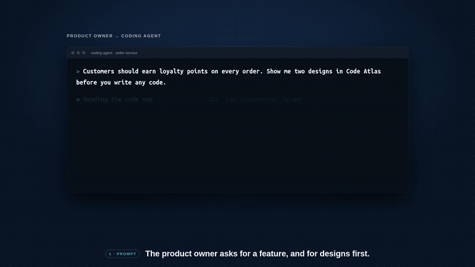

<div align="center">

# Code Atlas

## Stop reading files one by one. See the whole system.

**Explore unfamiliar code. Design with your coding agent. Review changes in context.**

Code Atlas turns Java and Spring repositories into interactive, source-backed maps—so you can understand what exists, shape what comes next, and review what changed without losing the big picture.

[**Watch the demo**](#see-code-atlas-in-action) · [**Get started**](#get-started) · [**Why Code Atlas?**](#why-code-atlas)

[](https://github.com/sajjadvalaei110/prompt-proof/actions/workflows/ci.yml?branch=main)
[](https://github.com/sajjadvalaei110/prompt-proof/releases/latest)


[](LICENSE)

</div>

## See Code Atlas in action

<p align="center">
  <a href="trailer/out/code-atlas-trailer-voice.mp4">
    
  </a>
</p>

<p align="center">
  <strong>Prompt → design → build → review.</strong><br>
  <a href="trailer/out/code-atlas-trailer-voice.mp4"><strong>Watch the full 71-second demo with narration and music</strong></a>
</p>

## Why Code Atlas?

Reading a large codebase through isolated files is slow. Reviewing agent-written code without architectural context is harder still.

Code Atlas gives you one visual workspace for both:

- **Find your footing faster.** Explore packages, classes, methods, dependencies, and entry points on an interactive map instead of assembling the architecture in your head.
- **Follow behavior to the source.** Trace calls, Spring routes, dependency injection, and other relationships, then jump directly to the exact source evidence behind them.
- **Design before you implement.** Sketch packages, resources, members, and relationships directly on the map. Keep proposed designs visibly separate from parsed code and export a brief for your coding agent.
- **Review changes in context.** See added, modified, and removed code on the same map, including changed relationships and line counts. Open unified or side-by-side diffs when you need every detail.
- **Add explanations without giving up control.** Use a local model through LM Studio, Ollama, or another OpenAI-compatible endpoint—or skip AI entirely and keep exploring offline.

## Built for understanding, not guesswork

**Parser facts and AI explanations are deliberately separate.** Static analysis owns the graph; a model can explain it, but cannot invent or rewrite its structure.

- Every parsed relationship carries source evidence and an explicit resolution status.
- Candidate, unresolved, designed, and stale information stays visible instead of being presented as fact.
- Source-only analysis is the default. Your repositories remain read-only data.
- The app binds to your local machine, with no required account, telemetry, or hidden cloud fallback.
- Code is sent only to the model endpoint you configure. Graph exploration works when no model is available.

## Get started

### Download and run

**Requires Java 21. Node.js and a source checkout are not needed.** Download the self-contained JAR from [Code Atlas v0.1.0](https://github.com/sajjadvalaei110/prompt-proof/releases/tag/v0.1.0):

```bash
curl -fLO https://github.com/sajjadvalaei110/prompt-proof/releases/download/v0.1.0/code-atlas-0.1.0.jar
```

Optionally verify its SHA-256 checksum before running it:

```bash
curl -fLO https://github.com/sajjadvalaei110/prompt-proof/releases/download/v0.1.0/code-atlas-0.1.0.jar.sha256
sha256sum -c code-atlas-0.1.0.jar.sha256
```

Start Code Atlas:

```bash
java -jar code-atlas-0.1.0.jar
```

Open **http://127.0.0.1:8085**, import a local Java project, and start exploring. Keep **Git** on your PATH if you want to use local change reviews.

### Build from source

**Requires Java 21, Node.js 22+, and npm 9+.** The included Gradle wrapper does not need a separate Gradle installation.

```bash
git clone https://github.com/sajjadvalaei110/prompt-proof.git
cd prompt-proof
cd frontend && npm ci && cd ..
./gradlew bootJar
java -jar build/libs/code-atlas-0.1.0.jar
```

See [Contributing](CONTRIBUTING.md) for development-mode instructions and verification checks.

## Optional: bring your own local AI

Code Atlas works with OpenAI-compatible local model servers:

- **LM Studio:** start its local server, load a code-capable model, and configure its endpoint and model ID in Code Atlas.
- **Ollama:** run `ollama serve`, pull a model such as `qwen2.5-coder`, and point Code Atlas at its OpenAI-compatible endpoint.

No model? No problem. The map, source navigator, relationship evidence, Spring insights, design tools, and change review remain available.

## Explore the project

- [Architecture](docs/ARCHITECTURE.md) — modules, trust boundaries, and data flow
- [Local change review](docs/GIT_REVIEW.md) — Changes mode and diff behavior
- [Exploration tabs](docs/EXPLORATION_TABS.md) — independent journeys, history, and navigation
- [Design layer ADR](docs/adr/0014-design-layer.md) — authored designs kept separate from parser facts
- [Testing](docs/TESTING.md) — automated and browser verification
- [Changelog](CHANGELOG.md) — user-facing changes and release history
- [Security policy](SECURITY.md) — supported versions and private vulnerability reporting
- [Contributing](CONTRIBUTING.md) — development setup, project boundaries, checks, and pull requests

## License

Code Atlas is licensed under the [Apache License 2.0](LICENSE). See [NOTICE](NOTICE) for project attribution.

---

<div align="center">

**Understand the system. Choose the design. Own the change.**

If that is the workflow you want, [star Code Atlas](https://github.com/sajjadvalaei110/prompt-proof), try it on a codebase you know, and share what would make it indispensable.

</div>
